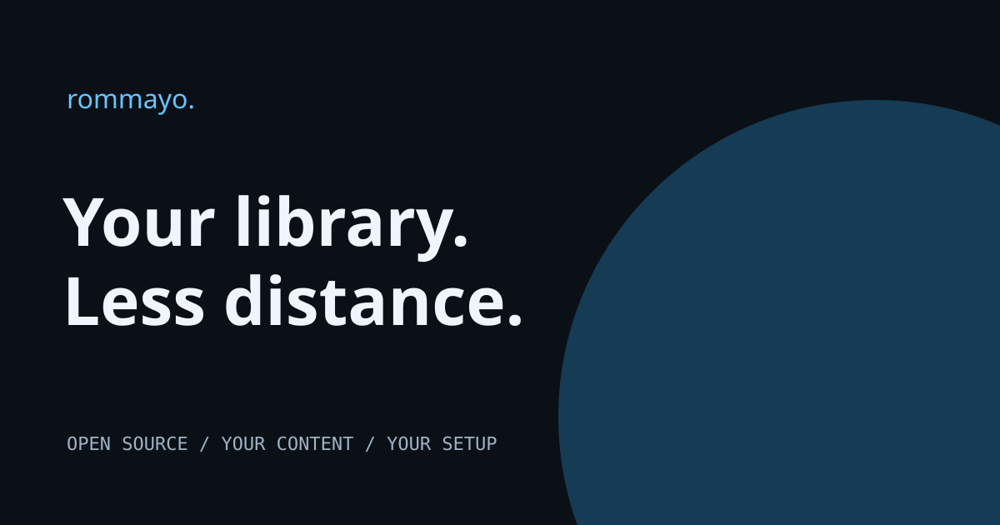

<p align="center"></p>

# Rommayo · The website

**[Visit rommayo.quentinmayo.com](https://rommayo.quentinmayo.com)** for product details, setup and compatibility notes.

A public, login-free Next.js website for Rommayo. Dark library-inspired design, original fictional cover art, responsive layouts and an interactive preview. No games, BIOS files, server credentials, analytics or visitor accounts are included.

The companion app lives at **[quentinmayo/Rommayo](https://github.com/quentinmayo/Rommayo)**. Android uses native library screens; desktop uses Electron. Browser-based emulation and Full RomM use the upstream web interface.

## Install the app

Visit the [download section](https://rommayo.quentinmayo.com/#downloads) for Android, macOS Apple Silicon/Intel, Windows and Linux/Steam Deck installers. No Node.js or npm commands are needed to use the app. Packages and checksums live in [Rommayo Releases](https://github.com/quentinmayo/Rommayo/releases/tag/v0.2.9).

## Tested devices

Physical hardware checks recorded October 22, 2026. These are specific smoke tests, not certification of every game, core or controller. CI builds for Windows and Intel Mac do not count as physical device tests. No device serials or private server details are published.

| Device | Environment | Verified | Still to check |
| --- | --- | --- | --- |
| Samsung Galaxy S24 Ultra | Android 17 | Signed APK; native library; remembered login after force-stop. | Physical external-controller gameplay not verified. |
| Retroid Pocket 5 | Android 13 | Signed APK; landscape native library; remembered login after force-stop; owner confirmed native D-pad navigation and Recent platform filter opening, D-pad movement, fresh A selection and B cancellation. | Physical left-stick menu and gameplay bindings require further checks. |
| Steam Deck | SteamOS, docked 1920 × 1080 | AppImage installation; automatic session restore; Desktop Mode C64 boot; toolbar pause/resume; Quit; Steam artwork; Gaming Mode launch. | Physical gameplay controls not yet verified. |
| MacBook Pro (Apple M4 Pro) | macOS, Apple Silicon | Electron launch, session and download regression tests. | Other emulator cores and systems are not certified. |

[Setup and current device notes](https://rommayo.quentinmayo.com/getting-started#tested-devices).

## Develop this website locally

```sh
npm ci
npm run dev
```

`npm run build` creates a static export in `out/`. The Docker image builds the Next.js source and serves it with unprivileged Nginx on port **8080**. No production Node server or environment secrets are required by the public site.

## Deploy with Coolify

Use a dedicated project and a public Git application, branch `main`, Dockerfile build pack, `/Dockerfile`, exposed port `8080`, health check `/`, and the HTTPS production domain above. The app runs independently of the upstream game service.

The repository's workflow calls the organization's pinned centralized security workflow, runs the production build and dependency audit, and requests a Coolify deployment only after both pass on `main`. Configure repository variable `COOLIFY_APPLICATION_UUID` and secret `COOLIFY_API_TOKEN`; credentials never go into the source or browser bundle. Organization onboarding attaches the shared security configuration and runner access.

## Security & responsibility

Centralized scans include CodeQL plus centralized secret detection, dependency, infrastructure and workflow analysis as provided by `securelyprogramming/security-workflows`. A configured workflow is not proof that a particular scan has passed; inspect the latest Actions results and Security tab.

Use only content you are authorized to access. Downloads and use are at your own risk. This independent companion is not affiliated with upstream projects or Valve. No third-party ROM sourcing is supported. Website code is MIT licensed; upstream applications, runtimes and emulator cores retain their own licenses.

## Support the developers ☕

I need help affording my AI token usage :) If this project makes your setup a little more fun, [buy the developers a coffee](https://buymeacoffee.com/quentinmayo). Always optional. Always appreciated. The project stays free and open source.

## Search & sharing

The public site includes descriptive page titles, canonical URLs, indexable HTML, PNG social cards, WebSite/Person JSON-LD, a linked [setup guide](https://rommayo.quentinmayo.com/getting-started), `robots.txt` and a three-page sitemap. Each page has its own canonical URL and social metadata. Keep titles, descriptions and sitemap entries in sync when adding pages; regenerate `public/og.png` from `public/og.svg` if the social artwork changes.

For indexing diagnostics, verify the production domain in Google Search Console or Bing Webmaster Tools, submit `/sitemap.xml`, and inspect the home and guide URLs. These tools require the site owner's account; publishing metadata does not register the site or guarantee a ranking.

Follow the [illustrated Steam Deck guide](https://rommayo.quentinmayo.com/steam-deck) for screenshots, controls and troubleshooting.


